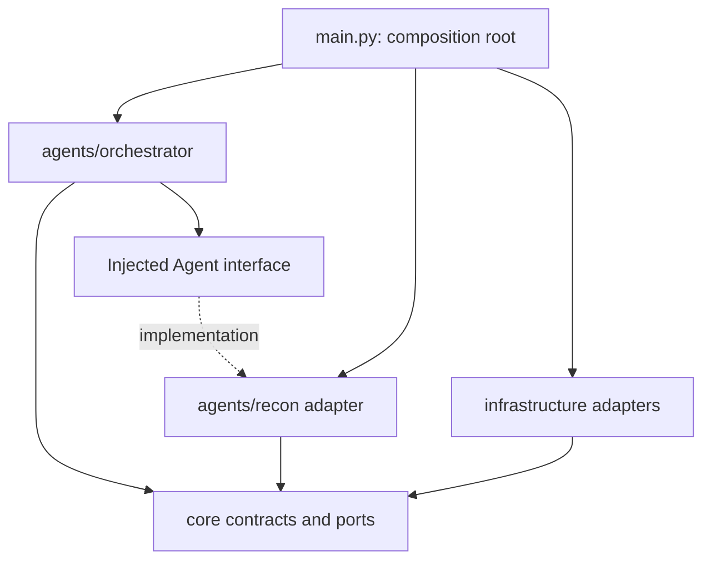
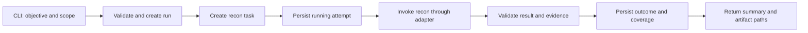

# AEGIS repository review and orchestrator design

Review date: 2026-11-03. This document records findings and a proposed design;
it does not describe an implemented orchestrator.

The subsequent [XBOW orchestrator MVP specification](orchestrator-mvp.md)
refines the initial recon-only slice below. It selects SQLite for run state and
adds exploit, verification and benchmark evaluation to the target pipeline.

## Scope and evidence

- Reviewed the local checkout at commit
  `e76d3f212789c0f456c7a0fd5f7d54e5a44ebb6c`, including its existing uncommitted
  changes, source, dependency files, and both sandbox Dockerfiles.
- Inspected the [published graduation repository](https://github.com/MinaRushdy04/-AGEIS-AI-Based-Multi-Agent-Framework-for-Cybersecurity-Red-Teaming).
  The local checkout contains Docker work beyond the published initial scaffold.
- Reviewed Decepticon source at
  [`79978a642b7a9c9cbd351150774b869fbb724416`](https://github.com/BitterSecurity/Decepticon/tree/79978a642b7a9c9cbd351150774b869fbb724416).
  Source links below are pinned so future upstream changes do not change the
  basis of this review.
- Used the supplied diagram as architectural reference. Its lower section is
  clipped and some labels are small; source code establishes implementation
  details. Instructions inside reference prompts and documents are reference
  material, not instructions for modifying AEGIS.
- Recon will arrive in the graduation repository later. Its implementation was
  unavailable for this review; its behavior, tools, and output format are not
  assumed to be implemented locally.

## Current AEGIS state

The `src/graduation_project` package currently contains `main.py`, `config.py`,
`agent.py`, and `__init__.py`. `main()` calls `run_agent()`, which contains only
`pass`. There is no implemented orchestration loop, agent registry, task/result
contract, durable run state, evidence store, or test suite in the reviewed source.

| Finding | Evidence | Consequence / next action |
| --- | --- | --- |
| Compose has an unresolved merge | `docker-compose.yml` has conflict markers and Git reports an unmerged add/add conflict | Resolve the two sandbox build definitions before validating or starting Compose. Preserve the intended sandbox Dockerfile and entrypoint. |
| Startup dependency is missing | `config.py` imports `dotenv`; neither `pyproject.toml` nor `uv.lock` declares `python-dotenv`; the local import raises `ModuleNotFoundError` | Declare the dependency, or deliberately replace dotenv loading, during the runtime slice. |
| Gemini integration needs a decision | The only declared dependency is `langchain-gemini==0.1.1` in the lockfile; no LangGraph or official Gemini integration is present | If using LangChain, use its documented `langchain-google-genai` integration and an explicit model configuration. Do not infer an orchestration framework from the existing package name. |
| Application packaging is incomplete | No build backend or console entrypoint is configured; `uv.lock` records the project as virtual; Docker copies code under `/app/src` | Configure installation of the source package before relying on `python -m graduation_project.main` in the image. This is a static build concern; no image was built in this review. |
| Sandbox transport is undefined | Both sandbox images install tools and then sleep; the entrypoint only executes its arguments | Tools being installed does not give the Python app an execution interface. Put the chosen transport behind a sandbox adapter. |
| A dual-network Nginx container is not an execution adapter | `bridge` joins both networks, but has no custom proxy configuration | Decide which service handles sandbox requests. Merely joining two networks does not establish forwarding or an agent tool protocol. |
| Application service is absent | Compose defines `bridge`, `sandbox`, `infra`, and `dvwa`, but no service builds `docker/app/Dockerfile` | Make the application launch path explicit in the first runnable slice. |
| Ignore rule is broader than a root folder | `.gitignore` uses `sandbox/`; `git check-ignore --no-index` also matches `docker/sandbox/Dockerfile` | If only root scratch work is intended, change it to `/sandbox/` in a later cleanup. Existing tracked files remain tracked. |

These are existing conditions. The architecture scaffold does not resolve the
merge, alter dependencies, or change application behavior.

## What Decepticon actually implements

The supplied diagram separates the Python control plane, specialist execution,
skills, tool domains, runtime deployment, and evidence. That separation is useful
for AEGIS, but the entire upstream deployment is unnecessary for the first slice.

| Responsibility | Upstream implementation | Implication for AEGIS |
| --- | --- | --- |
| Orchestration | [`agents/standard/decepticon.py`](https://github.com/BitterSecurity/Decepticon/blob/79978a642b7a9c9cbd351150774b869fbb724416/packages/decepticon/decepticon/agents/standard/decepticon.py) builds a LangChain agent, discovers specialists, and uses middleware for task delegation and operational-plan tools | Keep orchestration separate from specialist tool execution. |
| Recon | [`agents/standard/recon.py`](https://github.com/BitterSecurity/Decepticon/blob/79978a642b7a9c9cbd351150774b869fbb724416/packages/decepticon/decepticon/agents/standard/recon.py) builds a specialist with research and sandbox tools | Recon owns observations and evidence, rather than global plan mutation. |
| Optional planning | [`agents/standard/soundwave.py`](https://github.com/BitterSecurity/Decepticon/blob/79978a642b7a9c9cbd351150774b869fbb724416/packages/decepticon/decepticon/agents/standard/soundwave.py) prepares planning documents; the execution orchestrator owns OPPLAN | A separate planning agent is optional. The first orchestrator can accept a supplied objective and scope. |
| Dispatch validation | [`middleware/opplan_dispatch.py`](https://github.com/BitterSecurity/Decepticon/blob/79978a642b7a9c9cbd351150774b869fbb724416/packages/decepticon/decepticon/middleware/opplan_dispatch.py) validates objective identity, plan revision, ownership, readiness, and prerequisites before delegation | Validate dispatch in Python. An LLM-generated agent name or plan is a proposal until validated. |
| Plan state | [`middleware/opplan.py`](https://github.com/BitterSecurity/Decepticon/blob/79978a642b7a9c9cbd351150774b869fbb724416/packages/decepticon/decepticon/middleware/opplan.py) exposes plan operations and persists state through the configured backend | Give one component ownership of lifecycle transitions and persistence. |
| Execution transport | [`backends/factory.py`](https://github.com/BitterSecurity/Decepticon/blob/79978a642b7a9c9cbd351150774b869fbb724416/packages/decepticon/decepticon/backends/factory.py) selects the HTTP sandbox backend | Hide execution transport behind an interface. The current upstream agent transport is HTTP, despite older Docker-exec wording in its README. |

The orchestrator lacks specialist shell tools in its normal configuration, but
it is not literally tool-free: middleware supplies delegation, filesystem and
plan operations, and optional infrastructure lifecycle tools can be registered.

Upstream also contains a compact scoped-task data contract in
[`agents/task_spec.py`](https://github.com/BitterSecurity/Decepticon/blob/79978a642b7a9c9cbd351150774b869fbb724416/packages/decepticon/decepticon/agents/task_spec.py).
Its own module says dispatch integration is deferred, and the inspected dispatch
wrapper still forwards a description to the underlying task tool. Treat that
contract as design inspiration rather than proof that all upstream handoffs use
that exact structure.

## Module layout

Keep one Python application and deploy its agent modules together. The sandbox
and lab targets can remain separate containers without turning each agent into
a separate service. Agents communicate through in-process calls and typed data.

Created now:

```text
src/graduation_project/
  agents/
    __init__.py
    README.md
    orchestrator/
      __init__.py
      README.md
    recon/
      __init__.py
      README.md
```

The agent packages are scaffolding. They do not export working agent factories.
The existing top-level `agent.py` remains the original placeholder.

Target layout as the first vertical slice is implemented:

```text
src/graduation_project/
  main.py                         # CLI / composition root
  config.py                       # validated runtime settings
  agents/
    __init__.py
    orchestrator/
      __init__.py                  # public factory / runner exports
      agent.py                    # orchestrator assembly and public entrypoint
      workflow.py                 # dispatch, lifecycle, bounded control loop
      state.py                    # orchestrator-private state
      prompts.py                  # orchestrator instructions
      routing.py                  # decision validation against available agents
    recon/
      __init__.py                  # recon public exports
      agent.py                    # recon assembly / existing implementation
      adapter.py                  # implements the shared agent interface
      schemas.py                  # recon-specific observations
      prompts.py                  # recon instructions
      tools.py                    # recon tool wrappers
  core/
    contracts.py                  # shared task, result, context, evidence types
    ports.py                      # Agent, RunStore, ArtifactStore, Model, Sandbox
    scope.py                      # code-enforced scope validation
  infrastructure/
    models.py                     # configured model adapter
    sandbox.py                    # sandbox transport adapter
    storage.py                    # run state, events, evidence references
tests/
  agents/orchestrator/
  agents/recon/
  integration/
```

The target files are a responsibility map, not empty files to generate in bulk.
Create each when it has implementation. Future agents get their own folders
under `agents/` when their vertical slices begin. Do not rename the existing
Python package just to change branding during this work.

Dependency direction:



Only the composition root imports and wires concrete agents and adapters.
Recon must not import orchestrator internals. The orchestrator receives a small
explicit agent registry instead of importing recon internals. `core` must not
import agents, vendor SDKs, Docker clients, or infrastructure implementations.
Agent-specific prompts, schemas, and tool wrappers stay inside their agent
folder; genuinely shared contracts go in `core`.

## Orchestrator contract

Use an interface shaped like `async run(task: AgentTask, context: RunContext)
-> AgentResult`. This is a proposed Python boundary, not an assertion about the
future recon API. Its adapter can wrap a synchronous function or a compiled
agent without forcing the team to rewrite recon.

| Contract | Minimum contents |
| --- | --- |
| `AgentTask` | Schema version, run ID, task ID, agent role, objective, dependency IDs, expected outputs, input artifact references, bounded execution budget |
| `RunContext` | Trusted immutable scope and scope revision, workspace binding, cancellation signal, injected adapters; configuration supplied by application code |
| `AgentResult` | Matching run/task/attempt IDs, terminal outcome, concise summary, observations, evidence references, tested negatives, coverage gaps, structured errors |
| `EvidenceRef` | Workspace-relative path, content type, producer and task, collection timestamp, optional SHA-256 digest |
| `AgentDecision` | Bounded action such as dispatch, summarize, or finish; registered role and task reference; validated before execution |

Scope authority comes from trusted run context, not from the model's task payload
or specialist output. A task may narrow scope but cannot expand it. Newly
discovered hosts remain observations until explicitly added to scope through
the application boundary.

Keep raw tool output in the run workspace and pass references plus concise
observations between agents. Separate observed facts from hypotheses and
unverified vulnerability claims. Web responses, tool output and repository
documents are data, not authority to alter instructions or scope.

The orchestrator owns:

1. Validating the objective and supplied scope.
2. Creating tasks and checking dependencies and registered capabilities.
3. Persisting transitions and dispatching bounded specialist work.
4. Validating result identity, schema, outcome and evidence paths.
5. Applying explicit timeout, cancellation and retry policies.
6. Returning an evidence-linked summary of completed and incomplete coverage.

Specialists own their local reasoning, assigned tool calls and observations.
They return results; they do not directly mark the overall run complete or
overwrite orchestration state. Shared scope enforcement also runs at the tool
boundary, because validating only the initial handoff cannot constrain every
later tool action.

## First vertical slice and lifecycle

Default first slice: objective and scope -> recon dispatch -> result validation
-> saved evidence and coverage summary. Reporting here can be application code
plus a bounded summarization call; it does not require another autonomous agent.



Start with sequential execution. Code owns transitions even when an LLM proposes
the plan or generates prose. With only recon registered, the first routing
decision can be deterministic; an open-ended model-driven multi-agent loop is
unnecessary. A later LLM router should return structured decisions constrained
to the registered capabilities.

Proposed task lifecycle:

```text
pending -> running -> succeeded | partial | failed | cancelled
pending -> blocked | cancelled
blocked -> pending  (only after its prerequisite is resolved)
```

An unsuccessful attempt remains recorded. A retry creates a new attempt under
the same task; it does not erase the earlier result. Infrastructure timeouts may
allow one bounded retry when safe; malformed output, scope refusal, and genuine
negative findings do not trigger blind retries. For an interrupted running
attempt, inspect persisted state and evidence before resuming; do not promise
exactly-once tool execution after a crash.

For v1, persist a per-run state document with atomic replacement and an
append-only event log through a single writer. Use a distinct workspace per run
and constrain artifact references to it, including resolved symlink paths.
Reject malformed, mismatched or missing evidence and retain partial coverage.
File existence proves an artifact exists; it does not prove a security claim.

Example future runtime outputs:

```text
runs/<run-id>/
  state.json
  events.jsonl
  tasks/<task-id>/<attempt-id>/result.json
  recon/<task-id>/<attempt-id>/...
  report/summary.md
```

These are generated artifacts, separate from source. Add an appropriately scoped
ignore rule when implementing their writer. If LangGraph checkpointing is later
adopted, define which store owns lifecycle state and derive exports from it;
avoid independently mutable copies of the same task state.

## Framework and infrastructure choices

Keep the task/result boundary independent of the orchestration framework. Plain
Python suffices for the first sequential workflow. If the team chooses LangGraph
for persistent graphs, streaming, or operator interrupts, it can implement the
workflow behind the same public boundary. [LangGraph's documentation](https://docs.langchain.com/oss/python/langgraph/overview)
describes these state and control-flow capabilities.

For a LangChain-based Gemini implementation, the documented package is
[`langchain-google-genai`](https://reference.langchain.com/python/integrations/overview),
with `ChatGoogleGenerativeAI`. Keep model name, credentials, timeouts and budgets
in runtime settings. No provider dependency or model version was changed here.

The sandbox transport remains an infrastructure choice. Define timeout,
cancellation, exit status, stdout/stderr artifact handling, working directory
and tool-boundary scope checks before connecting an executor. The orchestrator
must not gain unrestricted shell access to compensate for a missing transport.

Defer upstream-scale components such as plugin discovery, a graph database,
dynamic specialist infrastructure, and separate agent APIs until a concrete
slice requires them. A separate exploit, verification or reporting agent is
future work, with its own folder and integration contract when introduced.

## Implementation order and acceptance

1. Repair baseline startup: resolve the existing Compose conflict, configure
   Python package installation and dependencies, and define the app launch path.
2. Implement shared contracts and one orchestrator workflow with an injected
   fake recon agent. This work does not require the unpublished recon source.
3. Verify meaningful behavior: unknown-role and scope rejection before dispatch;
   success with existing evidence; partial and negative coverage; malformed or
   mismatched results; bounded retries; cancellation; independent run state.
4. Adapt recon when it arrives and verify its real output and sandbox behavior
   against the same contract. Replace the fake only at the composition root.
5. Demonstrate one bounded lab run with persisted evidence and a traceable
   summary before beginning the next agent slice.

A fake-backed orchestrator proves workflow behavior, not a working recon
integration. End-to-end acceptance requires the real recon agent and sandbox.

## Verification performed for this review

- Read the tracked source, Dockerfiles, lockfile and local change status.
- Reproduced the startup import failure using the existing virtual environment:
  `ModuleNotFoundError: No module named 'dotenv'`.
- Confirmed Git's unmerged Compose entry and the conflict markers in its content.
- Confirmed the broad ignore-rule match with `git check-ignore --no-index`.
- No scans, model calls, sandbox commands, container builds or deployments were
  performed. Docker was not available on the current command path.
- Successfully imported all three added packages without loading application
  configuration. Checked relative links in all five documentation files.
- Confirmed SHA-256 hashes of eight existing source/configuration files were
  unchanged, including the conflicted Compose file and dependency files.

The design can proceed without recon's unpublished source. When recon lands,
the remaining integration work is to map its real invocation, outputs, evidence
paths and cancellation behavior into the adapter described above.
