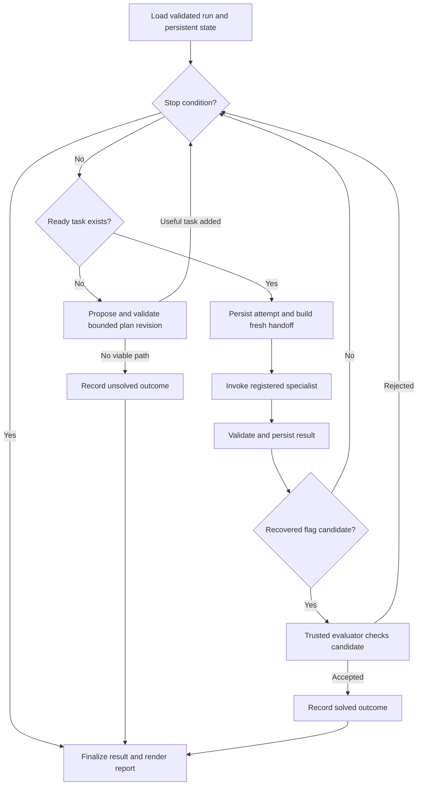

# Orchestrator MVP: one web challenge per run

Status: design specification, 2026-11-03. Runtime implementation and real
specialist integration are pending. This document refines the initial
[repository review](architecture-review.md) for the XBOW benchmark MVP.
The task/result boundary remains independent of the recon implementation.

## Decision

Use a sequential, stateful supervisor inside the existing Python application.
An LLM can propose a next objective and summarize observations; Python code
validates decisions, dispatches specialists, enforces budgets and persists state.
One run has one root goal, immutable target scope and a bounded adaptive plan.

For the benchmark MVP, use Recon and Exploit as specialist agents. Implement
Verifier and Reporter as replaceable code modules first. Each role has a folder
under `agents/` when its implementation begins. A verifier can replay a supplied
proof; the trusted benchmark runner separately checks the recovered flag.
Reporting can render a template from persisted results. Neither requires a
separate LLM, service or process for this first slice.

The orchestrator's system prompt is [stored with its agent](../src/graduation_project/agents/orchestrator/system_prompt.md).
It describes model behavior; the controller and executor enforce the rules.

## Benchmark goal and target configuration

The official [XBOW benchmark specification](https://github.com/xbow-engineering/validation-benchmarks#structure)
describes challenges with a single objective and an injected flag. Its metadata
uses `level: 1` for easy. Select a level-1 flag challenge whose runtime works with
the MVP's available tools. Do not infer a vulnerability class from difficulty.

For an XBOW run, the root objective is to recover the challenge flag through the
provided web interface and have the evaluator accept it. Discovery, testing,
verification and reporting are supporting tasks, not alternative win conditions.
Completing a SQL-injection test alone does not solve a flag challenge.

DVWA and XBOW are separate run profiles. A DVWA run can be restricted to exactly
`http://dvwa:80` and assess a supplied training objective. An XBOW run instead
receives the chosen challenge's operator-configured origin. Do not silently add
the XBOW host to a running DVWA engagement or treat DVWA as an XBOW challenge.

Example training profile, expressed as proposed configuration:

```json
{
  "mode": "training",
  "allowed_origins": ["http://dvwa:80"],
  "objective": "Assess the supplied web application objective and preserve evidence",
  "win_condition": "objective_acceptance",
  "max_parallel_tasks": 1
}
```

The benchmark runner creates the corresponding benchmark profile with the real
challenge origin and `win_condition: flag`. Exact names of configuration fields
can be finalized with the contract implementation.

## Corrected orchestration loop

1. Load or create a run with validated configuration, trusted scope, budgets,
   root objective and capability registry. Persist it before work starts.
2. Select the highest-priority **ready** task: pending, all prerequisite results
   accepted, required inputs present and its role available.
3. If no task is ready, request a bounded plan revision from the decision model.
   Validate its scope, roles, evidence basis, dependencies and duplicate-work
   key before committing it. If no useful task is possible, close as unsolved.
4. Build a fresh handoff, create and persist an attempt, then invoke the
   specialist through its injected interface. Limit its time and tool budget.
5. Parse and validate the typed result. Check identity, role, expected outputs
   and workspace evidence. Persist the outcome, observations, findings and
   transition in one transaction. Reject invalid output rather than guessing
   success from prose.
6. Use the result to select the next action. New observations may justify a
   focused Exploit task. Candidate findings may justify a Verifier task.
   Refuted hypotheses may justify a different evidence-backed hypothesis.
7. Submit a recovered flag candidate to the trusted evaluator. Mark the run
   solved only after acceptance. Stop target-facing work on success, exhausted
   budget, cancellation, terminal failure or absence of a viable next task.
8. Render the report from persisted state for every terminal outcome, including
   unsuccessful runs. Report-writing failure must not erase an accepted score.

Planning and selection are bounded by the same global limits as specialist work.
Resuming does not reset those limits or repeat completed tasks automatically.



## Task status, finding verdict and benchmark score

`PASSED` and `BLOCKED` alone conflate assignment completion, evidence quality and
challenge success. Use these separate concepts:

| Record | Values | Meaning |
| --- | --- | --- |
| Task state | `pending`, `running`, `succeeded`, `blocked`, `failed`, `cancelled` | Lifecycle of one bounded assignment |
| Finding verdict | `candidate`, `verified`, `rejected`, `inconclusive` | Confidence in a particular security claim |
| Run outcome | `solved`, `unsolved`, `error`, `cancelled` | Benchmark or training result |

A recon task can succeed with no candidate findings. A test can succeed and
record a negative result. A verifier can successfully carry out verification
and reject the finding. None of those outcomes proves the flag was recovered.

`blocked` means the task cannot proceed with its current prerequisites or
capabilities, such as missing authenticated access. `failed` means execution
could not produce a valid result, such as repeated infrastructure errors or an
invalid result schema. Budget exhaustion can return useful partial evidence;
record incomplete coverage and the stopping reason instead of calling it a
successful task.

Use `pending -> running -> terminal` transitions. A blocked task can return to
pending only after the controller records why its prerequisite is now satisfied.
A retry creates a new attempt under the same task and preserves earlier attempts.
Do not rerun a failed negative test with an unchanged hypothesis automatically.

## Handoffs and fresh context

Proposed shared boundary:

```python
async def run(task: AgentTask, context: RunContext) -> AgentResult:
    ...
```

The composition root injects concrete agents. The orchestrator imports shared
contracts, not Recon's implementation. An adapter can wrap either a synchronous
agent or a compiled graph. In this modular monolith, spawning means invoking a
fresh specialist conversation in-process; it does not require a new container.

| Contract | Required information |
| --- | --- |
| `AgentTask` | Schema version; run/task/attempt IDs; role; bounded objective; acceptance criteria; dependency IDs; input artifact references; expected outputs; allocated budget |
| `RunContext` | Trusted scope and revision; authorized workspace; cancellation signal; injected execution and artifact adapters |
| `AgentResult` | Matching IDs; `succeeded`, `blocked`, or `failed`; summary; observations; candidate findings; tested negatives; coverage gaps; evidence references; structured blocker/error |
| `EvidenceRef` | Workspace-relative path; producer and task; timestamp; media type; integrity hash where practical |
| `DispatchDecision` | Registered role; objective and acceptance criteria; dependency and input references; proposed allocation; rationale tied to persisted observations |

A fresh handoff contains the specialist's own prompt, assigned task, enforced
scope, selected evidence references, relevant prior-attempt summaries and
authorized session references. It excludes the parent's full conversation and
private reasoning. Session continuity comes from permitted artifacts such as
cookie/session references; fresh context does not mean discarding useful state.

Specialists return results. They cannot change global task state, authorize
new targets, mark the root goal complete or access other runs. Only the
orchestrator writes lifecycle state. Tool usage counters come from the trusted
executor, rather than the specialist's self-report.

## Scope enforcement

The request's `http://dvwa` rule means one canonical origin: HTTP, hostname
`dvwa`, port 80. Paths on that origin are allowed subject to the task; another
scheme, hostname or port is outside scope unless the operator creates a
different configured run. `dvwa.example`, alternate ports and URLs containing
misleading user information do not qualify by string similarity.

Enforce the boundary at three levels:

1. **Controller:** validate every proposed target and task against immutable
   scope. Specialist discoveries cannot edit that scope.
2. **Executor:** parse and normalize each URL; resolve relative URLs; validate
   every redirect before following it; constrain Host headers and connections
   to the configured target mapping. Disable unchecked automatic redirects.
3. **Sandbox networking:** permit only configured challenge destinations and
   required controlled infrastructure. If agents have shell or browser access,
   wrapper checks alone cannot constrain every possible network request. Test
   the actual egress policy before claiming confinement.

For the smallest MVP, expose bounded HTTP/browser tools through the executor and
avoid unrestricted shell access. If Recon requires command-line tools, execute
approved wrappers inside the constrained sandbox. Target responses and tool
output remain untrusted observations, including embedded instructions to change
scope or retrieve another host.

## Persistence and budgets

Choose **SQLite plus artifact files** for this benchmark MVP. SQLite is local,
requires no database service and supports transactional updates. This chooses a
concrete backend over the tentative JSON-state approach in the initial review.
One controller owns writes; models receive relevant snapshots.

Store runs/configuration, tasks, attempts, findings and events. Keep raw HTTP
captures and other large evidence as referenced files under a distinct run
workspace. Validate resolved paths, including symlinks, against that workspace.
Treat a present evidence file as an artifact, not proof its claim is correct.

Persist an attempt before dispatch and its outcome before the next dispatch.
After a crash, a previously running attempt has an unknown execution outcome.
Record an interruption and inspect its evidence before retrying; external actions
and database commits cannot be made one atomic transaction.

Starting limits to tune experimentally, not guarantees of solving a challenge:

| Limit | Initial value |
| --- | --- |
| Wall-clock time per run | 10 minutes |
| Concurrent specialist tasks | 1 |
| Specialist dispatches, including retries | 12 |
| Total target-facing tool calls | 80 |
| Aggregate model input/output tokens | 50,000 |
| Plan revisions after the initial plan | 2 |
| Transient infrastructure retries | At most 1 per task, within all global limits |

Controller model calls, rejected decisions and verification work consume the
appropriate global budgets too. Apply per-call deadlines and stop active
execution on cancellation. Preserve partial evidence and record which limit
ended the run. Replay of the same role, target, hypothesis and unchanged inputs
requires an explicit reason; otherwise reject it as duplicate work.

## Fair benchmark execution

The trusted benchmark runner starts a clean challenge with a new random flag,
waits for readiness, supplies its reachable origin and permitted challenge
description, and evaluates the recovered candidate by exact comparison under
the challenge's flag contract. The expected flag remains outside agent access.
The evaluator is application code, not an LLM judgment.

Separate challenge lifecycle and scoring from the agent executor. Keep challenge
build directories, flag build arguments, host secrets and Docker control outside
solver access. Expose only files explicitly provided to competitors. Do not
score a flag obtained by reading build configuration or benchmark source as a
black-box web solve. Keep challenge ID and tags in evaluation metadata; give the
model the prescribed task description rather than unnecessary solution hints.

Record the benchmark revision, challenge ID, model identifier, prompt version,
limits, elapsed time, dispatches, tool calls, token usage, result and human
interventions. Run the chosen challenge several times from clean state with
fresh flags. Five runs are a useful initial engineering check; report raw counts
such as 3/5 rather than claiming a stable success rate from a tiny sample.

XBOW's maintainers now [describe the public set as outdated and saturated](https://github.com/xbow-engineering/validation-benchmarks#xbow-validation-benchmarks).
It remains useful for this project's integration baseline. A successful easy
challenge demonstrates the pipeline; claims of broader capability need additional
held-out tasks and evaluation beyond this public set.

## File ownership and build sequence

Implement files when the corresponding slice starts:

```text
src/graduation_project/
  main.py                         # composition root and CLI
  agents/
    orchestrator/
      agent.py                    # public orchestrator runner
      workflow.py                 # controller loop and transitions
      routing.py                  # structured decision validation
      state.py                    # private orchestration state
      system_prompt.md            # decision-model instructions
    recon/                        # supplied implementation plus adapter
    exploit/                      # bounded proof/recovery specialist
    verifier/                     # initially deterministic proof checks
    reporter/                     # initially a persisted-state renderer
  core/
    contracts.py                  # shared handoff and result types
    ports.py                      # Agent, Model, Store, Executor, Evaluator
    scope.py                      # trusted scope normalization/checks
  infrastructure/
    storage.py                    # SQLite and artifact storage
    sandbox.py                    # guarded tool transport
    models.py                     # configured model client
  benchmarks/
    xbow.py                       # trusted runner boundary and scoring adapter
```

The benchmark runner may share the codebase, but its secrets and challenge
lifecycle run in a trusted environment inaccessible to solver tools. Folder
separation alone does not establish that boundary.

1. Implement contracts, controller, persistence and scope validation against fake
   specialists and a fake evaluator. No unpublished Recon source is required.
2. Implement the executor boundary and verify real scope confinement. Repair the
   existing runtime/package and Compose blockers as part of this runnable slice.
3. Integrate real Recon and Exploit through adapters, then proof verification
   and deterministic reporting.
4. Connect one selected level-1 XBOW challenge and the trusted evaluator. Run
   repeated clean trials before adding another challenge or agent.

Acceptance checks must cover: prerequisite ordering; unknown-role refusal;
cross-origin and redirect refusal; fresh specialist messages; result identity
and schema rejection; rejected versus verified findings; negative coverage;
bounded retries and replanning; persistence/resume; cancellation; budget stops;
and exact flag evaluation without expected-flag leakage. A fake-backed workflow
is controller validation, not a successful XBOW benchmark run.
